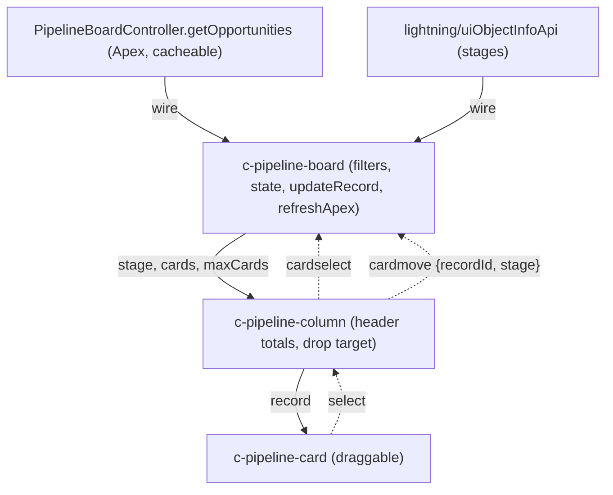

# lwc-pipeline-board

[](https://github.com/idrisimo/lwc-pipeline-board/actions/workflows/ci.yml)
[](LICENSE)

A drag-and-drop Opportunity pipeline Kanban board for Salesforce, built with Lightning Web Components. Stages come straight from your org's `StageName` picklist, cards load through a secure Apex controller, and moving a card updates the record instantly with optimistic UI and automatic rollback if the save fails.

## Features

- Columns generated dynamically from the Opportunity `StageName` picklist (`getObjectInfo` + `getPicklistValues`)
- Column headers show card count and total Amount (`lightning-formatted-number`, org currency)
- Filters: owner (My / All), close date range, and debounced search by Opportunity or Account name
- HTML5 drag and drop between columns, persisted with `updateRecord`
- Optimistic UI with rollback and an error toast on failure; `refreshApex` after each change
- Click a card (or press Enter) to open the record via `NavigationMixin`
- Configurable max cards per column in App Builder; overdue open deals highlighted
- SLDS-only styling, responsive with horizontal scroll
- Exposed on App Pages, Home Pages and Tabs
- Apex: `with sharing`, `WITH USER_MODE`, bind variables only, escaped `LIKE` input, row limit, optional closed-stage exclusion
- Jest tests for every component, Apex tests with `@TestSetup` and the `Assert` class

## Component architecture



| Component        | Responsibility                                                                                 |
| ---------------- | ---------------------------------------------------------------------------------------------- |
| `pipelineBoard`  | Loads stages and data, owns filters and optimistic state, saves moves, navigates, shows toasts |
| `pipelineColumn` | Renders header count and total, handles drag over and drop, emits `cardmove` and `cardselect`  |
| `pipelineCard`   | Renders one Opportunity, is draggable, emits `select`                                          |

## Project structure

```
force-app/main/default/
  classes/            PipelineBoardController + test
  lwc/                pipelineBoard, pipelineColumn, pipelineCard (+ Jest tests)
  tabs/               Pipeline_Board tab
  flexipages/         Pipeline_Board App Page
  permissionsets/     Pipeline_Board_User
data/                 Sample Accounts and Opportunities (sf data import tree)
config/               Scratch org definition
```

## Deploy

Prerequisites: [Salesforce CLI (`sf`)](https://developer.salesforce.com/tools/salesforcecli), a Dev Hub org, Node 20+.

```bash
git clone https://github.com/idrisimo/lwc-pipeline-board.git
cd lwc-pipeline-board
npm install

# 1. Create a scratch org (requires an authorised Dev Hub)
sf org create scratch --definition-file config/project-scratch-def.json --alias pipeline-board --set-default --duration-days 7

# 2. Deploy the source
sf project deploy start

# 3. Assign the permission set
sf org assign permset --name Pipeline_Board_User

# 4. Import sample data (5 Accounts, 15 Opportunities across stages)
sf data import tree --plan data/sample-data-plan.json

# 5. Open the org, then use the App Launcher to find "Pipeline Board"
sf org open
```

To use the board in an existing org, deploy to it with `sf project deploy start --target-org <alias>`, assign the permission set, then add the **Pipeline Board** tab to an app or drop the `pipelineBoard` component on any App, Home or Tab page.

> Sample data close dates are fixed values. Edit `data/Opportunity.json` if you want them relative to today.

## Running tests

### Jest (LWC)

```bash
npm run test:unit            # run tests
npm run test:unit:coverage   # with coverage report
npm run lint                 # ESLint (@salesforce/eslint-config-lwc)
npm run prettier:verify      # formatting check (npm run prettier to fix)
```

### Apex

Apex cannot run locally, so tests need an org:

```bash
sf apex run test --class-names PipelineBoardControllerTest --result-format human --code-coverage --wait 10
```

CI runs lint, Prettier and Jest. An optional scratch-org Apex job is included, commented out, in `.github/workflows/ci.yml`; enable it after adding a Dev Hub auth URL as the `SFDX_AUTH_URL` secret.

## Screenshots

_Screenshots coming soon._

<!--  -->
<!--  -->

## Roadmap

- [ ] Inline quick-edit of Amount and Close Date on cards
- [ ] Per-user saved filters and collapsed columns
- [ ] Configurable card fields via App Builder / custom metadata
- [ ] Record type aware stage columns
- [ ] Keyboard-accessible card moves
- [ ] Optional weighted pipeline totals (Probability)
- [ ] Apex tests in CI against a scratch org

## License

[MIT](LICENSE) (c) 2026 Idris Silva
